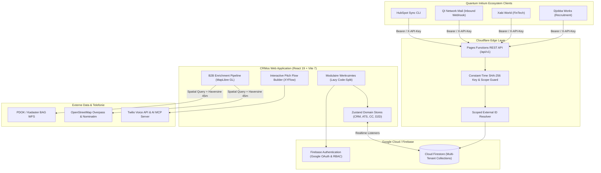

# CRMos — Multi-Tenant Enterprise CRM, ATS, Contact Center & Geospatial Intelligence OS

[](https://www.typescriptlang.org/)
[](https://react.dev/)
[](https://vitejs.dev/)
[](https://firebase.google.com/)
[](https://pages.cloudflare.com/)
[](https://maplibre.org/)

> **Executive Summary (NL):** **CRMos** (`crmos.one`) is een full-stack, multi-tenant Enterprise Operating System dat relatiebeheer (CRM), recruitment (ATS), omnichannel contactcenter-operaties (Twilio & AI Voice MCP), veldsales (Door-to-Door geospatial mapping met PDOK/BAG & OpenStreetMap) en een serverloze REST API v1 verenigt in één schaalbaar platform. Ontwikkeld als de centrale data- en integratiehub voor de 12+ ondernemingen binnen het **Quantum Initium** ecosysteem.
>
> **Executive Summary (EN):** **CRMos** (`crmos.one`) is a production-grade, multi-tenant Enterprise Operating System unifying Customer Relationship Management (CRM), Applicant Tracking (ATS), Omnichannel Contact Center operations (Twilio & AI Voice MCP), Geospatial Field Sales (PDOK/Kadaster BAG + OpenStreetMap Overpass enrichment pipeline), and an edge-deployed REST API v1 on Cloudflare Pages Functions & Google Cloud Firestore.

---

## Waarom dit project technisch onderscheidend is (For Technical Recruiters & CTOs)

In plaats van een losstaande CRUD-interface demonstreert **CRMos** hoe moderne enterprise-software over meerdere bedrijfsdomeinen heen wordt georkestreerd:

1. **Cryptografisch Beveiligde Edge REST API (`/api/v1`)**:
   - Gebouwd op **Cloudflare Pages Functions** met **constant-time SHA-256 API-key verificatie** (`constantTimeHexEqual`) om timing-attacks te elimineren.
   - Fijnmazige **scope-autorisatie** (`contacts:read`, `contacts:upsert`, `deals:create`, `deals:update`, `activities:create`) en strikte **per-key CORS Origin allowlisting**.
   - **Deterministische Idempotency & Scoped External IDs**: Ondersteunt `external_id` namespaces per API-key (`crm_external_ids`) met atomaire Firestore-precondities (`409 Conflict` preventie) en streaming payload-guards (max. 64 KiB).
2. **Drietraps Geospatial B2B Enrichment Pipeline (`b2bEnrichmentPipeline.ts`)**:
   - Combineert live overheidsdata uit **PDOK / Kadaster BAG (Basisregistratie Adressen en Gebouwen)** met **OpenStreetMap Overpass API** (via Haversine-afstandsmatching binnen 45 meter) en **KVK-handelsregistermutaties**.
   - Classificeert zakelijke panden (`winkelfunctie`, `kantoorfunctie`, `industriefunctie`, `bijeenkomstfunctie`, `logiesfunctie`, `gezondheidszorgfunctie`) en visualiseert deze realtime op een interactieve **MapLibre GL** vector-kaart voor Door-to-Door (D2D) en B2B-acquisitieteams.
3. **Node-Based Pitch Flow Engine & Twilio Telefonie (`@xyflow/react`)**:
   - Visuele beslisboom-editor voor callcenter-scripts, bezwaarafhandeling (*objection handling*) en dynamische pitch-flows.
   - Geïntegreerde **Twilio Voice & AI MCP** service met automatische Nederlandse E.164-nummernormalisatie (`06` / `020` → `+31`), gespreksopnames en realtime call-logging in Firestore.
4. **Multi-Tenant Ecosysteem-Architectuur**:
   - Fungeert als centrale hub voor **Djobba Works** (recruitment & vacaturesynchronisatie), **Xabi World** (fintech & onboarding), **Quantum Initium Network Mail** (automatische inkomende e-mailcategorisatie met `mail.quantuminitium`-tagging) en **HubSpot CRM** migratie/sync.

---

## Systeemarchitectuur



---

## Kernmodules & Functionaliteiten

### 1. Enterprise CRM & 360° Klantbeeld
- **Contact- & Bedrijfsbeheer**: Volledige relatieprofielen met holding-tags (`vvc`, `djobba`, `xabi`, `woningvry`, `investbotiq`, etc.), lead-scoring, custom fields en activiteitentijdlijn.
- **360° Customer View (`/enhanced/360-view`)**: Geconsolideerde weergave van alle e-mails, telefoongesprekken, openstaande deals, offertes, sollicitaties en audit-events per relatie.
- **Globale Spotlight Zoekmachine (`Cmd+K` / `Ctrl+K`)**: Direct doorzoeken van duizenden contacten, bedrijven, deals, kandidaten en vacatures vanuit elke pagina.

### 2. Sales, Deal Pipelines & CPQ (Configure, Price, Quote)
- **Kanban & Lijst Dealpijplijnen (`/crm/deals`)**: Drag-and-drop dealmanagement (`@dnd-kit`) over de fasen `lead`, `qualified`, `proposal`, `negotiation`, `closed-won` en `closed-lost` met gewogen omzetprognoses.
- **Productcatalogus & Offertemodule (`/sales/quotes`, `/sales/products`)**: Samenstellen van zakelijke offertes met regelitems, kortingspercentages, automatische btw-berekening en statusopvolging.

### 3. Recruitment & Applicant Tracking System (ATS)
- **Vacature- & Kandidatenbeheer (`/recruitment/jobs`, `/recruitment/candidates`)**: Beheer van zowel publieke als vertrouwelijke holding-vacatures (13 strategische groepsrollen), inclusief CV-parsing metadata, skills-matching en interview-stages.
- **Bidirectionele Djobba-koppeling**: Sollicitaties en interim-aanvragen vanuit Djobba Works stromen realtime binnen als gekwalificeerde kandidaten en deals.

### 4. Omnichannel Contact Center & AI Voice Workspace
- **Agent Workspace (`/contact-center/workspace`)**: Gecentraliseerde bel- en communicatiecockpit met wachtrijbeheer, live gesprekstimer, klantspecifieke pitch-scripts en directe dispositie-logging (`call`, `whatsapp`, `sms`, `email`, `meeting`).
- **Node-Based Pitch Flow Builder (`/contact-center/pitch-flows`)**: Interactieve canvas-editor (`@xyflow/react`) waarmee salesmanagers gespreksroutes, keuzeknooppunten en bezwaarafhandeling ontwerpen.
- **Campagnebeheer (`/contact-center/campaigns`)**: Outbound en inbound belcampagnes met conversieratio's en agent-toewijzing.

### 5. Geospatial Data Intelligence & Door-to-Door (D2D) Field Sales
- **B2B Enrichment Pipeline (`/data-intelligence`, `/enhanced/territories`)**:
  - **Stap 1 (PDOK BAG)**: Haalt officiële Nederlandse verblijfsobjecten en gebruiksdoelen op binnen de geselecteerde stad of bounding box.
  - **Stap 2 (OSM Overpass)**: Verrijkt elk BAG-pand via Haversine-coördinaatmatching ($\le 45\text{m}$) met bedrijfsnaam, branche, telefoonnummer, website en openingstijden.
  - **Stap 3 (KVK Mutaties & Gebiedsindeling)**: Koppelt recente bedrijfsinschrijvingen, adreswijzigingen en rayon-verdelingen aan veldverkopers op een interactieve **MapLibre GL** kaart.

### 6. Gamification, Workflows & Custom Dashboards
- **Dashboard Builder (`/enhanced/dashboard-builder`)**: Zelf samenstellen van KPI-dashboards met aanpasbare widgets en panelen (`react-resizable-panels`).
- **Workflow Automatisering (`/enhanced/workflows`)**: Event-gedreven triggers (bijv. *Deal Won* → taak aanmaken + welkomstmail + Slack/webhook notificatie).
- **Gamification & Leaderboards (`/enhanced/gamification`)**: XP-punten, prestatiebadges, salestargets en realtime team-ranglijsten.
- **Governance & Audit Logs (`/admin/audit-logs`)**: Volledige traceerbaarheid van wie welk record heeft aangemaakt, gewijzigd of geëxporteerd.

---

## CRMos Edge REST API v1 Specificatie

De serverloze API in [`functions/api/v1/[[path]].ts`](functions/api/v1/[[path]].ts) ondersteunt externe integraties binnen en buiten het netwerk:

| Methode & Endpoint | Vereiste Scope | Beschrijving |
| :--- | :--- | :--- |
| `GET /api/v1/health` | *Publiek* | Healthcheck & runtime-status van de Edge API. |
| `GET /api/v1/contacts?email=...` | `contacts:read` | Haal een contact op via e-mailadres, `vvc_tag` of `external_id`. |
| `POST /api/v1/contacts/upsert` | `contacts:upsert` | Idempotente contact-upsert met automatische tag-merging en `custom_fields` behoud. |
| `POST /api/v1/deals` | `deals:create` | Maak een nieuwe deal aan in `crm_deals` (ondersteunt `external_id` deduplicatie). |
| `PATCH /api/v1/deals/:id` | `deals:update` | Veld-specifieke update (`stage`, `value`, `probability`, `notes`, `custom`) op basis van deal-ID of `external_id`. |
| `POST /api/v1/activities` | `activities:create` | Log een activiteit (`call`, `email`, `meeting`, `task`, `note`, `whatsapp`, `sms`) gekoppeld aan een contact of deal. |

### Voorbeeld: Idempotente Contact Upsert

```bash
curl -X POST https://crmos.one/api/v1/contacts/upsert \
  -H "Authorization: Bearer <CRMOS_API_KEY>" \
  -H "Content-Type: application/json" \
  -d '{
    "external_id": "djobba:candidate_9481",
    "email": "thomas.bakker@example.nl",
    "first_name": "Thomas",
    "last_name": "Bakker",
    "phone": "+31612345678",
    "company": "FinTech Partners B.V.",
    "tags": ["djobba", "senior-engineer"],
    "custom": {
      "availability": "Direct",
      "hourly_rate": 115
    }
  }'
```

---

## Tech Stack

| Categorie | Technologieën |
| :--- | :--- |
| **Frontend Core** | React 19.2, TypeScript 5.9, Vite 7.2, React Router v7 |
| **State & Validatie** | Zustand v5 (modulaire domeinstores), React Hook Form v7, Zod v4 |
| **UI & Design Systeem** | Tailwind CSS 3.4, Radix UI Primitives, shadcn/ui (40+ componenten), Framer Motion 12, Lucide Icons |
| **Geospatial & Visualisatie** | MapLibre GL 6.14, PDOK BAG WFS, OpenStreetMap Overpass API, Recharts, `@xyflow/react` v12, `@dnd-kit` |
| **Backend & Edge API** | Cloudflare Pages Functions (Edge TypeScript runtime), Web Crypto API (SHA-256) |
| **Database & Auth** | Google Cloud Firestore (multi-tenant security rules & composite indexes), Firebase Authentication (Google OAuth) |
| **Integraties** | Twilio Voice & AI MCP, HubSpot CRM Sync (`scripts/sync-hubspot.mjs`), Quantum Initium Ecosystem API |

---

## Projectstructuur

```text
CRMos/
├── functions/
│   ├── api/v1/[[path]].ts         # Cloudflare Pages Edge REST API v1 (Auth, Contacts, Deals, Activities)
│   └── README.md                  # Edge API documentatie & scope-definities
├── src/
│   ├── components/
│   │   ├── 360-view/              # Geconsolideerde 360° klant- en tijdlijncomponenten
│   │   ├── d2d/                   # Door-to-Door veldsales & pand-inspectiecomponenten
│   │   ├── layout/                # Responsive Sidebar, Header & Apple-style mobiele navigatie
│   │   ├── maps/                  # MapLibre GL kaarten, clusters en B2B pins
│   │   ├── search/                # Cmd+K Global Spotlight Search (cmdk)
│   │   ├── telephony/             # Twilio WebRTC dialer & call-controls
│   │   └── ui/                    # 40+ herbruikbare Radix/shadcn UI-primitieven
│   ├── pages/
│   │   ├── crm/                   # ContactsPage, CompaniesPage, DealsPage, ActivitiesPage
│   │   ├── recruitment/           # CandidatesPage, JobsPage (ATS)
│   │   ├── sales/                 # QuotesPage, ProductsPage (CPQ)
│   │   ├── contact-center/        # AgentWorkspace, CampaignsPage, PitchFlowsPage
│   │   ├── enhanced/              # View360, Gamification, Territories, Workflows, DashboardBuilder
│   │   ├── admin/                 # AuditLogsPage
│   │   └── DataIntelligencePage.tsx # PDOK BAG + OSM B2B Enrichment interface
│   ├── services/
│   │   ├── b2bEnrichmentPipeline.ts # 3-traps PDOK BAG + OSM Overpass + KVK verrijkingspijplijn
│   │   ├── crmosApiClient.ts      # Frontend client voor de CRMos v1 API
│   │   ├── firestoreService.ts    # Realtime Firestore synchronisatie & multi-tenant queries
│   │   ├── hubspotService.ts      # Bidirectionele HubSpot CRM synchronisatie
│   │   ├── openMapService.ts      # Nominatim & geospatiale hulpfuncties
│   │   ├── twilioService.ts       # Twilio telefonie, E.164 formatting & AI MCP integratie
│   │   └── vvcTagService.ts       # Holding-brede VVC & ecosysteem tag-provisioning
│   ├── stores/                    # Zustand stores (auth, crm, recruitment, contactCenter, d2d, quotes, enhanced)
│   └── types/                     # Strikte TypeScript domeinmodellen
├── scripts/
│   ├── seed-company-api-keys.cjs  # Genereert en hasht multi-tenant API-sleutels
│   ├── sync-hubspot.mjs           # CLI-script voor HubSpot data-synchronisatie
│   └── open_geo_mcp.py            # Python geospatiale MCP-hulpmodule
├── firestore.rules                # Productie Firestore Security Rules
└── firestore.indexes.json         # Samengestelde Firestore-indexen
```

---

## Lokaal Ontwikkelen & Deployment

### Vereisten
- **Node.js** v20+ en `npm`
- Optioneel: een Firebase-project (`VITE_FIREBASE_*`) en Wrangler voor lokale Edge API-emulatie

### 1. Installatie & Ontwikkelserver
```bash
git clone https://github.com/JamalDrenthe/CRMos.git
cd CRMos
npm install
npm run dev
```

### 2. Omgevingsvariabelen (`.env`)
Maak een `.env` bestand aan in de projectroot voor Firebase-synchronisatie:
```env
VITE_FIREBASE_API_KEY=AIzaSy...
VITE_FIREBASE_AUTH_DOMAIN=crmosone-dev.firebaseapp.com
VITE_FIREBASE_PROJECT_ID=crmosone-dev
VITE_FIREBASE_STORAGE_BUCKET=crmosone-dev.appspot.com
VITE_FIREBASE_MESSAGING_SENDER_ID=...
VITE_FIREBASE_APP_ID=...
```

### 3. Productiebuild & Kwaliteitscontrole
```bash
npm run lint      # ESLint statische code-analyse
npm run build     # Strikte TypeScript-check (tsc -b) + geoptimaliseerde Vite bundle
npm run preview   # Bekijk de productiebuild lokaal
```

---

## Over de Architect & Samenwerking

Dit platform is ontworpen en gebouwd door **Jamal Drenthe** — Full-Stack Software Engineer, Systems Architect & Founder van **Quantum Initium**.

Ben je **recruiter**, **CTO** of **ondernemer** en zoek je een technisch leider of samenwerkingspartner die complexe multi-tenant platformen, AI-workflows, geospatiale datapijplijnen en high-conversion frontends van concept tot productie realiseert?

- **GitHub**: [@JamalDrenthe](https://github.com/JamalDrenthe)
- **E-mail**: [info@jamaldrenthe.com](mailto:info@jamaldrenthe.com)
- **Live Demo**: [crmos-eight.vercel.app](https://crmos-eight.vercel.app) / [crmos.one](https://crmos.one)
